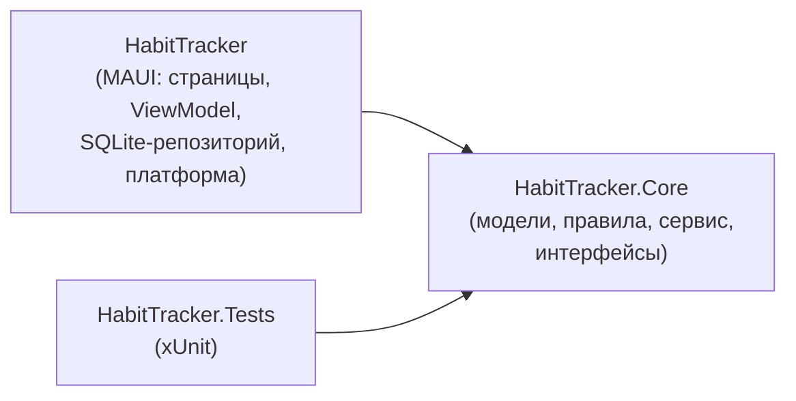
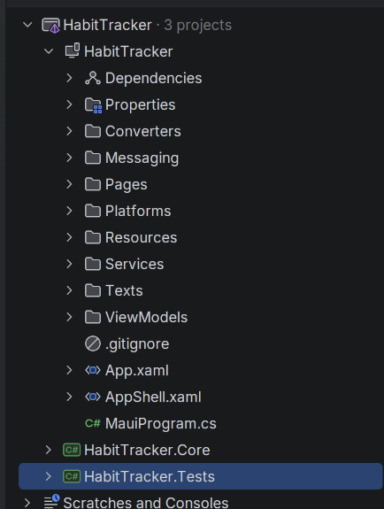
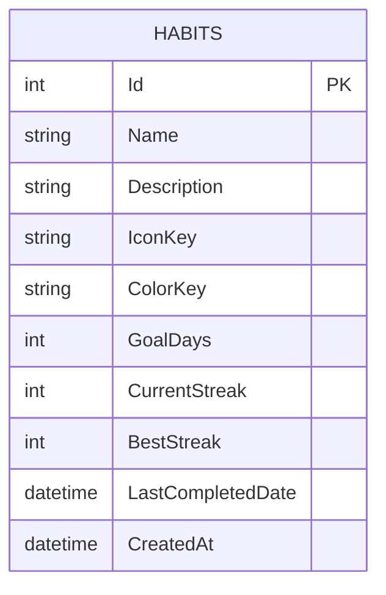
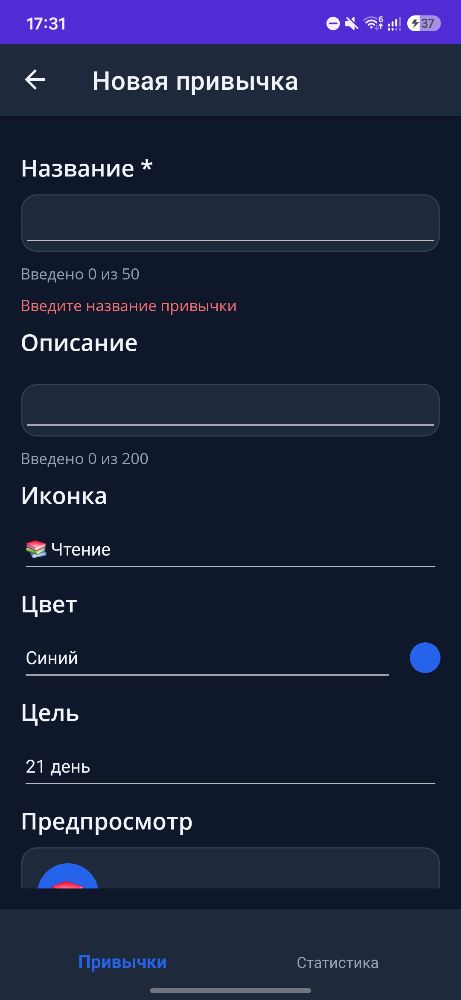
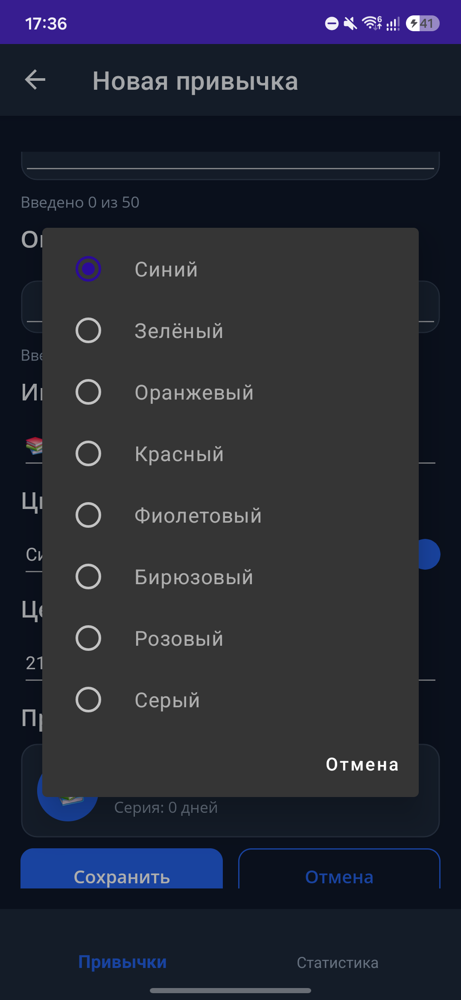
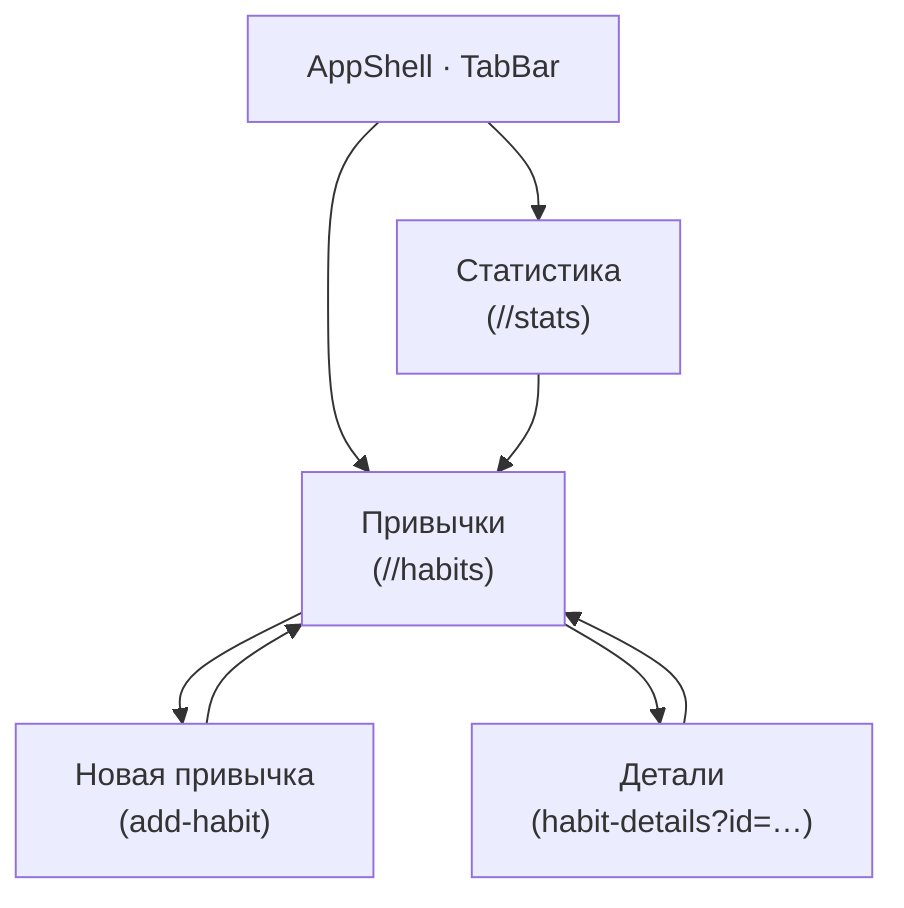
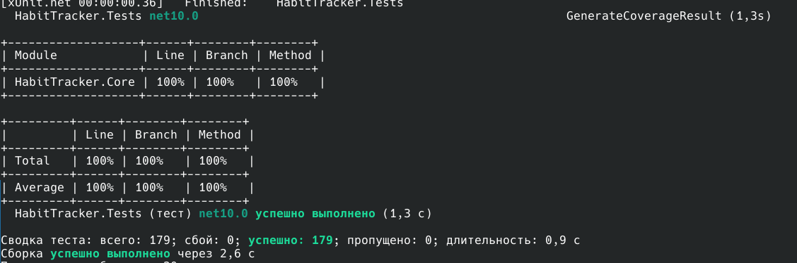
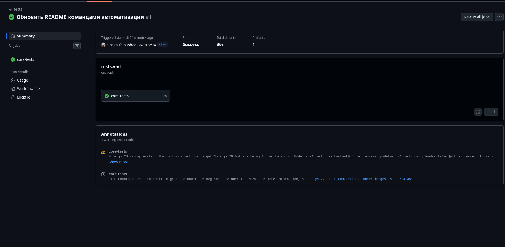

# Итоговая самостоятельная практическая работа. Приложение «Трекер привычек»

| | |
|---|---|
| Дисциплина | Разработка мобильных приложений на .NET MAUI |
| Тема | «Трекер привычек»: приложение для отслеживания ежедневных привычек |
| ФИО | Бондаренко Тимофей Денисович |
| Группа | 361 |
| Вариант | Детали привычки (экран 4) |
| Среда разработки | JetBrains Rider |
| Репозиторий | https://github.com/alaska-fe/HabitTracker |

## 1. Постановка задачи

Требовалось разработать автономное мобильное приложение для ведения ежедневных привычек: список с текущей серией дней подряд, добавление привычки (название, описание, иконка и цвет из `Picker`, цель в днях), отметка выполнения с ростом серии, прогресс до цели на `ProgressBar` и сводная статистика. Данные хранятся на устройстве в SQLite и сохраняются между запусками. Интерфейс — на русском языке, платформы — светлая и тёмная темы.

Реализовано:

| Требование | Статус |
|---|---|
| Три проекта: `HabitTracker`, `HabitTracker.Core`, `HabitTracker.Tests` | ✅ |
| `Core` без ссылок на MAUI | ✅ |
| Интерфейсы `IClock`, `IHabitRepository`, `IHabitService` + внедрение зависимостей | ✅ |
| Правила серии: сценарии S1–S12 | ✅ |
| Эффективная серия: сценарии E1–E5 | ✅ |
| Прогресс, лимиты, валидация | ✅ |
| Три обязательных экрана + «Детали» по варианту | ✅ |
| Навигация: переходы T1–T9 | ✅ |
| Уведомления N01–N16 | ✅ |
| Обработка ошибок по матрице 10.2 | ✅ |
| Тесты с покрытием ≥ 80 %, автозапуск, `pre-push`, CI | ✅ |

## 2. Архитектура

Решение состоит из трёх проектов. Зависимости направлены «внутрь»: приложение и тесты зависят от `Core`, сам `Core` не зависит ни от кого.



| Проект | Содержимое | Зависимости |
|---|---|---|
| `HabitTracker` | Страницы, ViewModel, конвертер, DI, `SqliteHabitRepository`, службы диалогов и навигации | MAUI, `HabitTracker.Core` |
| `HabitTracker.Core` | `Habit`, правила серии и прогресса, валидация, статистика, `HabitService`, интерфейсы | Только .NET; `sqlite-net-pcl` — ради атрибутов модели |
| `HabitTracker.Tests` | Тесты `xUnit`, тестовые двойники | `HabitTracker.Core` |

`Core` не ссылается на типы MAUI: цвет иконки хранится как HEX-строка, а преобразование `hex → Color` выполняется конвертером `HexToColorConverter` уже в приложении. Благодаря этому вся бизнес-логика покрыта тестами без запуска эмулятора.

Регистрация зависимостей (`MauiProgram.cs`):

| Тип | Время жизни |
|---|---|
| `IClock → SystemClock` | Singleton |
| `IHabitRepository → SqliteHabitRepository` | Singleton |
| `IHabitService → HabitService` | Singleton |
| `IDialogService`, `INavigationService` | Singleton |
| ViewModel всех страниц | Transient |
| Страницы | Transient |



## 3. Структуры данных

Единственная таблица — `Habits`:



Поля `Habit`:

| Поле | Тип | Ограничения | По умолчанию |
|---|---|---|---|
| `Id` | int | первичный ключ, автоинкремент | — |
| `Name` | string | обязательное, 3–50 символов после обрезки пробелов, уникально без учёта регистра | — |
| `Description` | string | необязательное, до 200 символов | пустая строка |
| `IconKey` | string | ключ из справочника иконок | `book` |
| `ColorKey` | string | ключ из справочника цветов | `blue` |
| `GoalDays` | int | одно из 7 / 14 / 21 / 30 / 66 / 100 | 21 |
| `CurrentStreak` | int | ≥ 0 | 0 |
| `BestStreak` | int | ≥ `CurrentStreak` | 0 |
| `LastCompletedDate` | `DateTime?` | только дата; `null` — ни разу не отмечена | `null` |
| `CreatedAt` | `DateTime` | устанавливается сервисом по `IClock`, а не `DateTime.Now` | — |

Принципиальное решение: `Habit` хранит только данные. Признаки «выполнена ли сегодня», «прогресс», «эффективная серия» не хранятся, а вычисляются в `Core` по `IClock.Today`. Поэтому серия не обнуляется в базе при пропуске дня — приложение может не запускаться несколько дней, а актуальность серии определяется сравнением `LastCompletedDate` с текущей датой.

В БД хранятся **ключи** справочников, а не значения (эмодзи и HEX), поэтому справочники можно менять без миграции данных. Поиск по неизвестному ключу возвращает значение по умолчанию, что защищает от повреждённых данных.

Иконки (`HabitIcons`, по умолчанию `book`): `water 💧`, `run 🏃`, `book 📚`, `yoga 🧘`, `sleep 💤`, `food 🥗`, `write ✍️`, `music 🎸`.

Цвета (`HabitColors`, по умолчанию `blue`): `#2563EB` Синий, `#16A34A` Зелёный, `#EA580C` Оранжевый, `#DC2626` Красный, `#7C3AED` Фиолетовый, `#0D9488` Бирюзовый, `#DB2777` Розовый, `#475569` Серый.

Файл БД — `habits.db3` в `FileSystem.AppDataDirectory`. Инициализация ленивая и потокобезопасная (`SemaphoreSlim` с двойной проверкой), как в `TaskDatabase` из работы №10.

## 4. Бизнес-правила

Правила вынесены в чистые статические классы `Core` и полностью покрыты тестами.

Отметка «выполнено сегодня» (`HabitRules.MarkCompletedToday`):

| № | Условие | Действие | Результат |
|---|---|---|---|
| R1 | `last == null` | `CurrentStreak = 1`, `last = today` | `Completed` |
| R2 | `last == today` | ничего не менять | `AlreadyDoneToday` |
| R3 | `last == today − 1 день` | `CurrentStreak += 1`, `last = today` | `Completed` |
| R4 | `last < today − 1 день` | серия прервана: `CurrentStreak = 1` | `Completed` |
| R5 | `last > today` | `HabitException(ClockMovedBack)`, данные не менять | — |
| R6 | после R1/R3/R4: `CurrentStreak > BestStreak` | `BestStreak = CurrentStreak` | — |
| R7 | после R1/R3/R4: `CurrentStreak == GoalDays` | результат `GoalReached` вместо `Completed` | `GoalReached` |

«Вчера» определяется календарно (`last.Date == today.AddDays(-1)`), а не разностью в 24 часа — это корректно для границ месяцев, лет, високосного дня и перехода на летнее время. `GoalReached` возвращается ровно один раз — в день, когда серия стала равна цели.

Эффективная серия (что показывать на экране):

| Условие | EffectiveStreak | IsStreakBroken |
|---|---|---|
| `last == null` | 0 | false |
| `last == today` или `last == today − 1` | `CurrentStreak` | false |
| `last < today − 1` | 0 | true |
| `last > today` | `CurrentStreak` | false |

Прогресс: `Progress = min(EffectiveStreak / GoalDays, 1.0)` — вещественное деление с ограничением сверху, чтобы `ProgressBar` не получил значение больше 1. Цель достигнута, если `EffectiveStreak >= GoalDays`; при серии выше цели индикатор остаётся на 100 %, а в тексте показывается реальная серия («25 из 21 дн.»).

Примеры расчёта серии (все покрыты тестами S1–S12):
- граница месяца: `31.01 → 01.02` продолжает серию;
- високосный день: `28.02.2028 → 29.02.2028`;
- граница года: `31.12.2026 → 01.01.2027`;
- пропуск дня прерывает серию, но рекорд сохраняется.

Сортировка списка — чистая функция `HabitSorter`: сначала невыполненные сегодня, внутри — по убыванию эффективной серии, затем по названию без учёта регистра; выполненные — в конце.

## 5. Экраны

Все цвета, отступы и размеры шрифтов вынесены в `ResourceDictionary`; в разметке нет «магических» значений. Темы заданы через `AppThemeBinding`. На каждой странице и в каждом `DataTemplate` указаны компилируемые привязки (`x:DataType`). У кнопок и индикаторов проставлены `SemanticProperties.Description`; интерактивные элементы не меньше 44×44.

### 5.1. Привычки (главная)

Карточка — вычисленное представление `Habit` на сегодняшнюю дату (`HabitCardModel`), реализует `INotifyPropertyChanged`, поэтому после отметки обновляется только одна карточка. Состояния списка: загрузка / данные / пусто / ошибка.


### 5.2. Новая привычка

Форма с валидацией: счётчики символов, ошибки показываются под полем после потери фокуса или нажатия «Сохранить» и исчезают при исправлении. `Picker` всегда имеет значение по умолчанию, поэтому `SelectedItem == null` невозможен. Живой предпросмотр карточки меняется по мере ввода.





### 5.3. Статистика

Три плитки-сводки, средний прогресс, лучшая текущая серия и рекорд; список строк с `ProgressBar`, «N из M» и процентом. Выполненная цель отмечена знаком 🏆. Порядок строк — по убыванию прогресса, затем по названию.


### 5.4. Детали привычки (функция по варианту)

Открывается по нажатию на карточку. Показывает название, описание, текущую и лучшую серию, дату создания, прогресс; есть кнопки «Отметить» и «Удалить». После удаления — возврат и обновление списка.


### 5.5. Тёмная тема


## 6. Навигация



| № | Откуда | Действие | Куда | Способ |
|---|---|---|---|---|
| T1 | Привычки | Кнопка «+» | Новая привычка | `GoToAsync("add-habit")` |
| T2 | Привычки (пусто) | «Добавить первую» | Новая привычка | то же |
| T3 | Новая привычка | «Сохранить» (успех) | Привычки | `GoToAsync("..")` + N01 |
| T4 | Новая привычка | «Сохранить» (ошибка) | — | остаться, данные не теряются |
| T5 | Новая привычка | «Назад» при вводе | Привычки | подтверждение, затем `..` |
| T6 | Новая привычка | «Назад» без ввода | Привычки | без подтверждения |
| T7 | Вкладка | Переключение | Статистика | пересчёт в `OnAppearing` |
| T8 | Статистика (пусто) | «Добавить привычку» | Привычки → Новая | `//habits`, затем T1 |
| T9 | Привычки | Нажатие на карточку | Детали | `habit-details?id=…` |

Переходы вызываются из ViewModel через `INavigationService`; в ViewModel нет прямой ссылки на `Shell`. Двойное нажатие на «+» не открывает страницу дважды — переход блокируется на время выполнения. Системная кнопка «Назад» и жест «назад» обрабатываются как «Отмена» через `ShellNavigatingEventArgs`.

## 7. Ошибки и уведомления

Ожидаемые бизнес-ошибки выбрасываются как `HabitException` с полем `Kind`; технические сбои преобразуются на границе слоя в `HabitException(Storage)`. ViewModel ловит `HabitException` и преобразует `Kind` в канал и текст. В каждой команде предусмотрен страховочный `catch (Exception)` с записью в журнал — приложение не падает, `IsBusy` сбрасывается в `finally`. Текст исключения пользователю никогда не показывается.

| Событие | Канал | Фактический текст |
|---|---|---|
| Привычка добавлена | Строка состояния | «Привычка «{имя}» добавлена» |
| Привычка отмечена | Строка состояния | «Отлично! Серия: {N} {дн.}» |
| Повторная отметка за день | Строка состояния | «Сегодня эта привычка уже отмечена» |
| Цель достигнута | Диалог | «Поздравляем! Цель «{имя}» — {N} {дн.} подряд — достигнута!» |
| Серия прервана | Карточка | «Серия прервана — начните снова сегодня» |
| Подтверждение удаления | Диалог | «Удалить привычку «{имя}»? Серия и прогресс будут потеряны.» |
| Привычка удалена | Строка состояния | «Привычка «{имя}» удалена» |
| Ошибка валидации поля | Inline | сообщения из `ValidationTexts` |
| Не удалось загрузить | Баннер + «Повторить» | «Не удалось загрузить привычки. Повторите попытку.» |
| Не удалось сохранить | Диалог / баннер | «Не удалось сохранить изменения. Повторите попытку.» |
| Дата раньше последней отметки | Диалог | «Дата на устройстве раньше последней отметки…» |
| Дубликат названия | Inline под «Название» | «Привычка с таким названием уже есть» |
| Выход с несохранённым вводом | Диалог | «Отменить ввод? Введённые данные будут потеряны.» |
| Список пуст | Пустое состояние | «Привычек пока нет. Добавьте первую!» |
| Лимит привычек | Диалог | «Достигнут предел: 30 привычек…» |
| Привычка не найдена | Строка состояния + перезагрузка | «Привычка не найдена. Список обновлён.» |

Скриншоты уведомлений:


## 8. Тестирование

- Всего тестов: **179** (с учётом наборов данных `[Theory]`).
- Покрытие строк `HabitTracker.Core`: **100 %**.
- Покрытие ветвей: **100 %**.
- Время выполнения набора: доли секунды — без сети, без реальной БД, без реального времени.

| Показатель | Требование | Факт |
|---|---|---|
| Количество тестов | ≥ 40 | 179 |
| Покрытие строк | ≥ 80 % | 100 % |
| Покрытие ветвей | ≥ 70 % | 100 % |

Покрыты все обязательные группы: правила серии S1–S12, эффективная серия E1–E5, прогресс, валидация, `HabitService` с двойниками, статистика, сортировка, склонения текстов, справочники.

Тестовые двойники: `FakeClock` (изменяемая дата) для проверки границ дат, `InMemoryHabitRepository` (список в памяти) и `FailingHabitRepository` (выбрасывает исключение) для проверки сбоев.



Обоснование порога 80 %: вся бизнес-логика в `Core` покрыта контрольными таблицами, поэтому фактическое покрытие 100 %. Порог задан как страховочный минимум на случай будущих правок. DTO-записи (`NewHabit`, `MarkResult` и др.) исключены из замера атрибутом `[ExcludeFromCodeCoverage]` — в них нет поведения.

## 9. Автоматизация

Запуск тестов при сборке приложения — цель MSBuild в проекте приложения (не в тестовом, чтобы тесты не запускались дважды при `dotnet test`):

```xml
<Target Name="RunCoreTests" BeforeTargets="Build"
        Condition="'$(SkipTests)' != 'true' and '$(DesignTimeBuild)' != 'true'">
  <Message Importance="high"
           Text="RunCoreTests: запуск тестов и порога покрытия перед сборкой приложения" />
  <Exec WorkingDirectory="$(MSBuildThisFileDirectory).."
        Command="dotnet test HabitTracker.Tests/HabitTracker.Tests.csproj /p:CollectCoverage=true /p:Threshold=80 /p:ThresholdType=line /p:ThresholdStat=total ..." />
</Target>
```

Отключение флагом `-p:SkipTests=true` нужно для быстрой итерации по интерфейсу, когда бизнес-логика не менялась.

Проверка перед отправкой — `pre-push`-хук в `.githooks/pre-push`, который прогоняет тесты с порогом покрытия. Проверка в `pre-push` выполняется локально и не даёт запушить нерабочий код; проверка в CI выполняется на чистом окружении для каждого `push` и `pull_request` и сохраняет отчёт покрытия как артефакт — это независимый второй рубеж.

`.github/workflows/tests.yml`: сборка `Core`, прогон тестов с покрытием, генерация HTML-отчёта, загрузка артефакта `coverage-report`.



## 10. Функция по варианту

Экран «Детали привычки» открывается по нажатию на карточку через маршрут `habit-details?id=…`; параметр `habitId` передаётся через `QueryProperty` и принимается ViewModel. Показываются название, описание, текущая и лучшая серия, дата создания, прогресс; доступны кнопки «Отметить» и «Удалить». После удаления на экране деталей выполняется возврат на главную и обновление списка.

Риски: список мог устареть, если привычку успели удалить в другом месте. Это обрабатывается: при `NotFound` показывается уведомление и список перезагружается.

## 11. Проблемы и решения

1. **Потеря файлов при создании ветки до слияния предыдущего PR.** При создании новой ветки от `main`, в который не был смержен предыдущий шаг, часть файлов «исчезала», и сборка падала с `CS0234` (тип не найден). Решение: перед созданием каждой ветки выполнять `git checkout main && git pull` и убеждаться, что предыдущий PR смержен.

2. **Опечатка в имени тестового файла.** Файл был сохранён как `HabbitRulesProgressTests.cs` (лишняя `b`), из-за чего `git add` не находил ожидаемое имя и индекс оставался пустым. Решение: проверить `git status`, переименовать файл и закоммитить заново. Вывод — сверять фактические имена файлов через `git status` перед коммитом.

3. **Подавление предупреждений вместо их устранения.** При обновлении пакета возникло предупреждение уязвимости `NU1903` для старой цепочки `sqlite-net-pcl`; первой реакцией было заглушить его через `NoWarn`. Это неверный путь: предупреждение указывало на реальную проблему в транзитивной зависимости. Решение: обновить `sqlite-net-pcl` до актуальной версии, после чего подавление было удалено, а проверка `--vulnerable` стала чистой.

4. **Особенность версии Java на Arch Linux.** Сборка выдавала предупреждение `XA0033` (нестандартная строка версии `openjdk 21.0.13.0.3`). Оно не влияет на результат — сборка завершается успешно, поэтому принято решение его игнорировать.

## 12. Вывод

Разработано законченное мобильное приложение «Трекер привычек» на .NET MAUI. Реализованы все обязательные требования: трёхпроектная архитектура с чистым `Core`, MVVM с внедрением зависимостей, хранение данных в SQLite с ленивой потокобезопасной инициализацией, правила серии и прогресса, обработка ошибок по матрице, каталог уведомлений, светлая и тёмная темы, а также 179 тестов со 100 % покрытием `Core` и автоматизация (автозапуск тестов при сборке, `pre-push`, CI).

Возможные улучшения:
- история всех отметок с календарём (вариант 5 из ТЗ);
- редактирование привычки;
- напоминания / локальные уведомления;
- экспорт и резервное копирование данных;
- виджеты и тёмная тема по расписанию.
